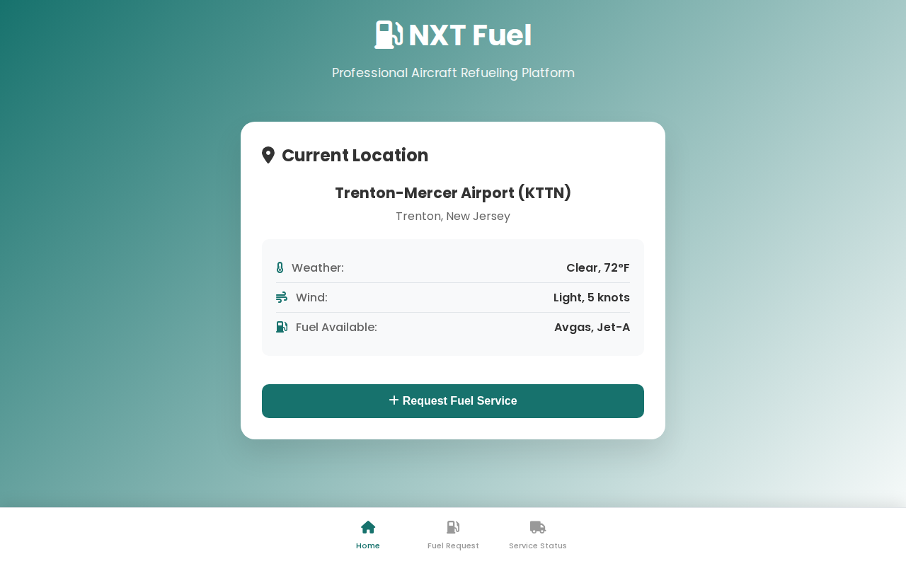
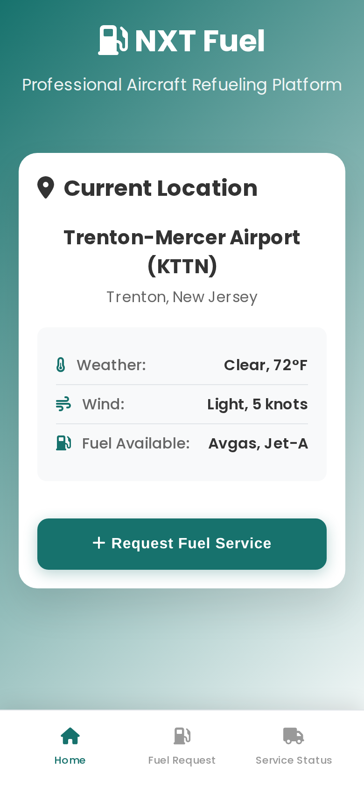
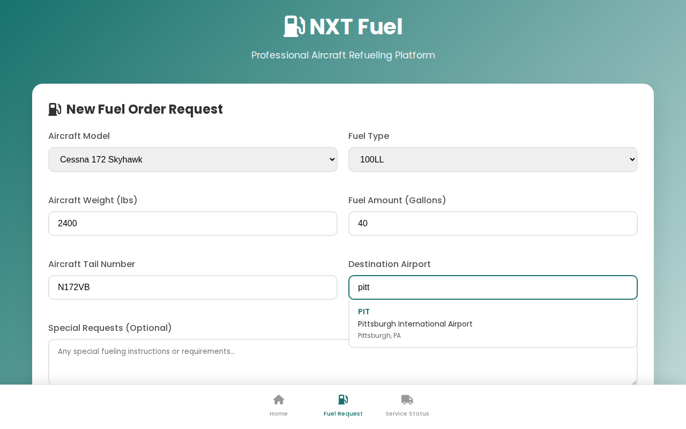
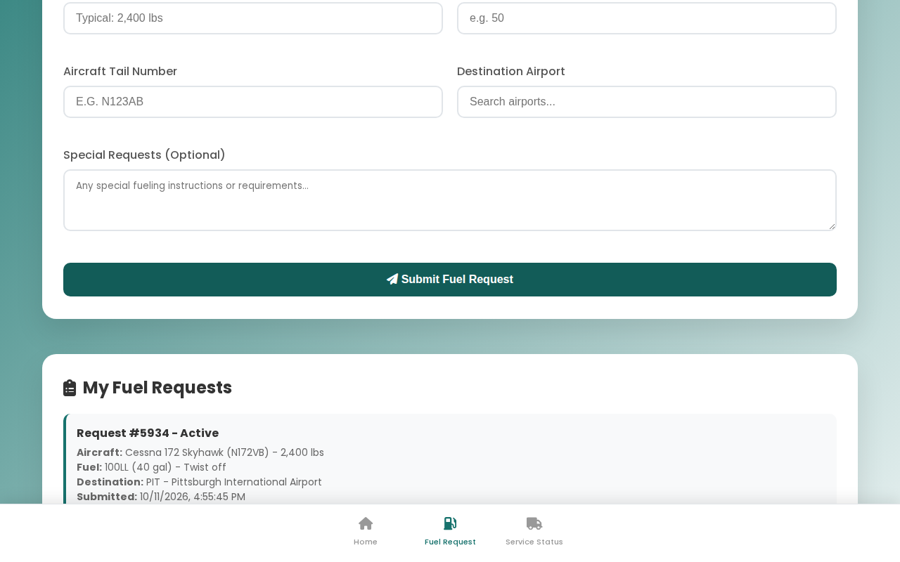
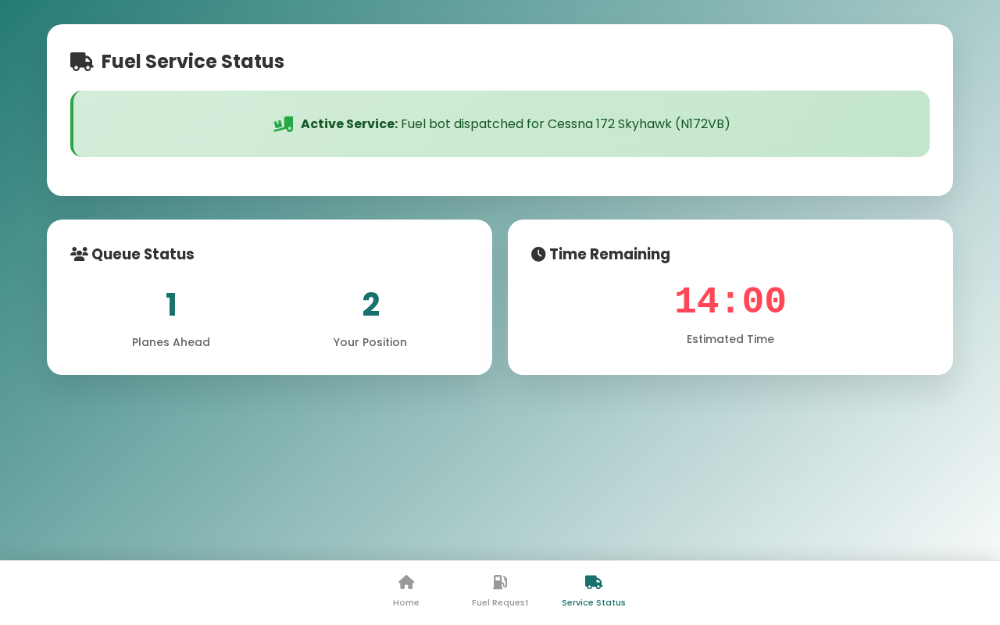
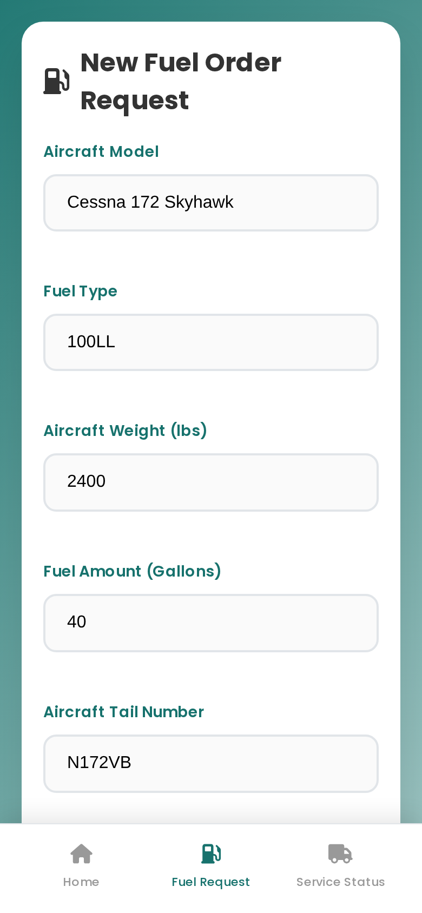
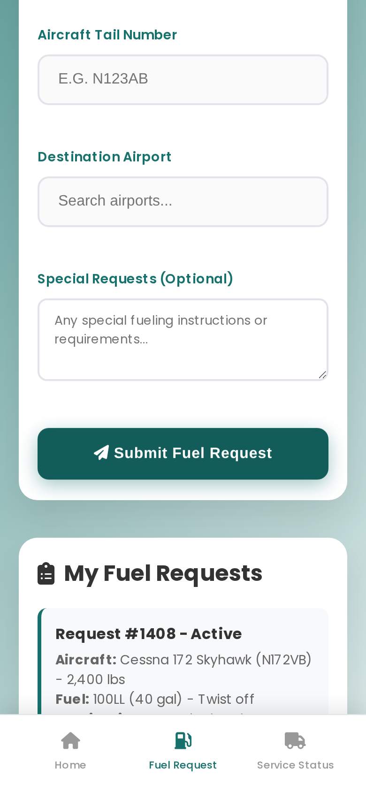
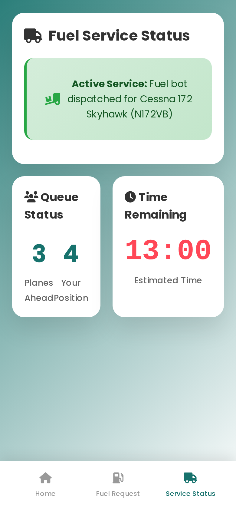

# NXT Fuel

A web app for ordering fuel for an aircraft from an automated fuel bot. Pick the aircraft and the app fills in the right fuel and nozzle, search for the destination airport, submit, and the order joins a queue with a live countdown until the bot arrives.

**[Live demo](https://viraj-bagga.github.io/NXT-Fuel/)** · one HTML file, no build, no backend · built as a hackathon demo

  
  &nbsp;
  

## Walkthrough

**1. Start at your airport.** Home shows where you are (Trenton-Mercer, KTTN, in the demo), the weather and wind, and which fuels are on the field.

**2. Fill in the order.** Choosing an aircraft sets the fuel type and nozzle and suggests a typical weight, so a Cessna 172 gets 100LL through a twist-off nozzle and a King Air or A320 gets Jet A-1 through a latch nozzle. Destination is a type-ahead search over 52 US airports by code, name, city or state.

**3. Submit.** The order is checked (required fields, tail number letters and digits only), confirmed, and listed under My Fuel Requests with its aircraft, fuel, nozzle and destination.

**4. Track the bot.** Service Status shows the bot dispatched to your aircraft, how many planes are ahead of you, and a countdown that moves through the service stages until fueling is complete. Only one active order is allowed at a time.

On a phone the same flow runs as a single column with a bottom tab bar:

  
  &nbsp;
  
  &nbsp;
  

## What is real and what is simulated

| Part | In this demo |
| --- | --- |
| Aircraft to fuel and nozzle mapping | Real data for 5 types: AW139, A320, Cessna 172, G550, King Air 350 |
| Airport search | 52 US airports, filtered client side |
| Form validation | Real: required fields, ranges, tail number pattern |
| Queue position and ETA | Simulated: 1 to 4 planes ahead, 10 to 25 minutes |
| The fuel bot | The idea being pitched; nothing is dispatched |

User input is escaped before it is rendered (#2), and every airport in the list can be selected, including O'Hare (#3).

## Running it

Open `index.html` in a browser. That is the whole app.

To deploy, serve `index.html` from any static host. The live demo is GitHub Pages on `main`.

## Repo layout

| Path | What it is |
| --- | --- |
| `index.html` | The app: markup, styles and script in one file |
| `scripts/screenshots.mjs` | Walks the app in Chromium and captures the images above; run by `.github/workflows/screenshots.yml` |
| `src/`, `public/`, `package.json` | An earlier React version (`npm install && npm start`) |
| `export/` | A standalone copy of the page with its own notes |

HTML, CSS, JavaScript, Font Awesome, Playwright for screenshots.
